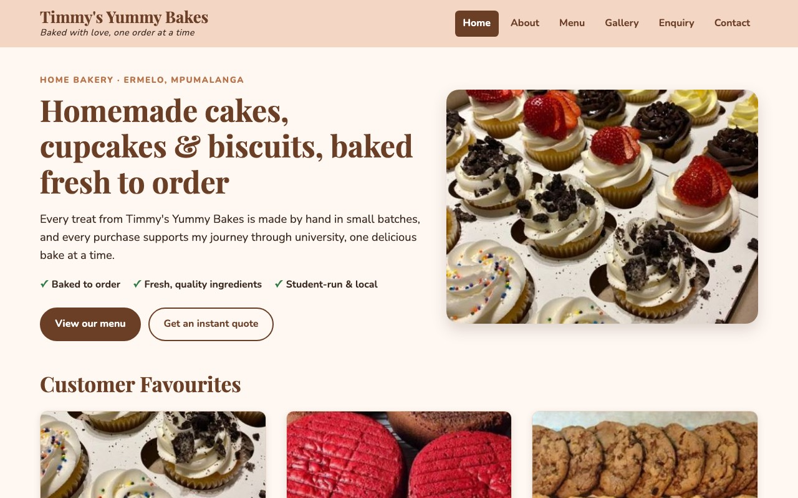
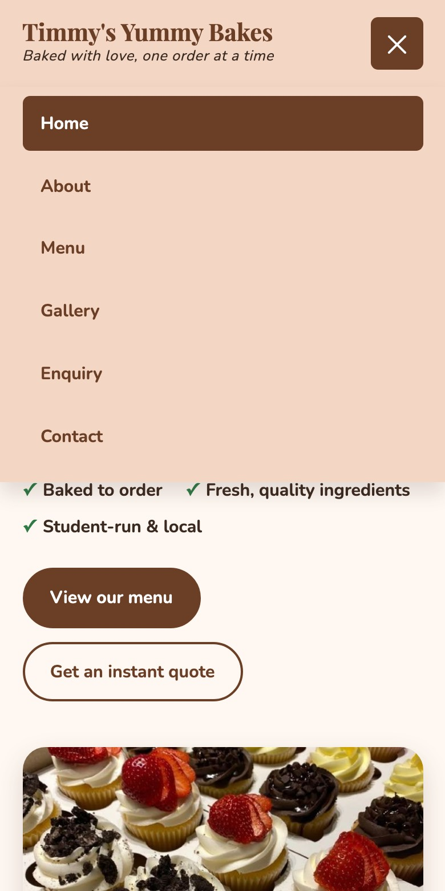
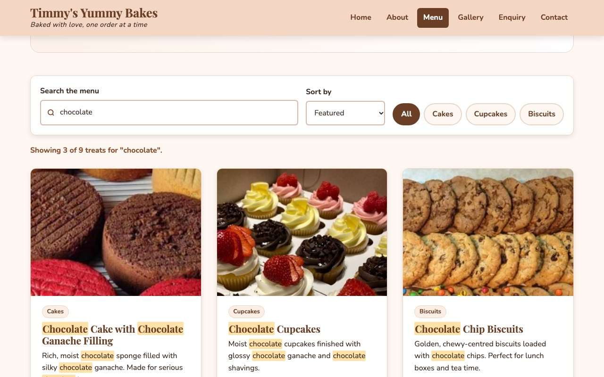
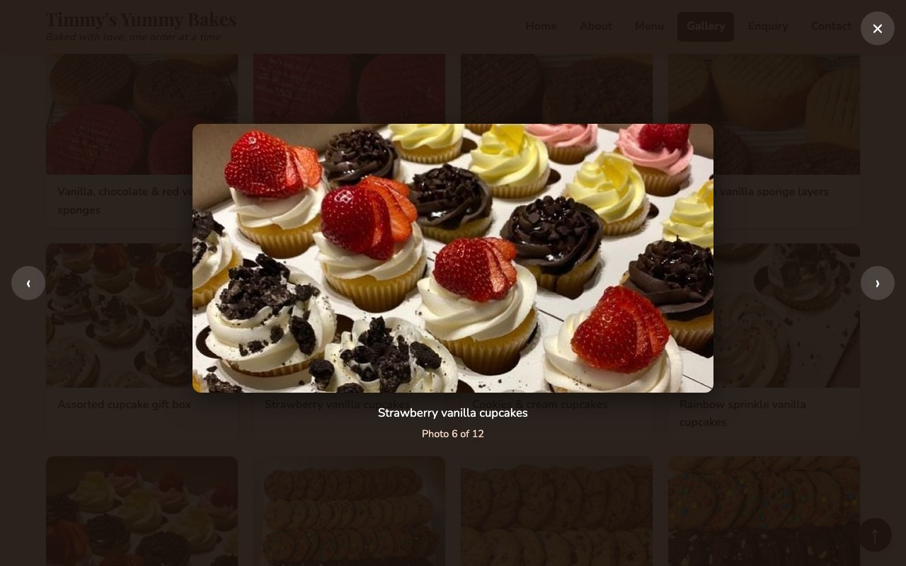
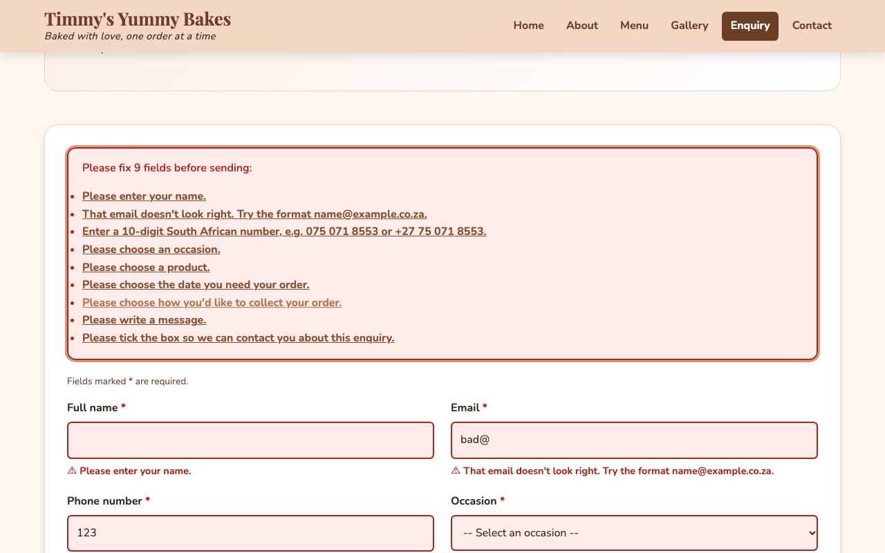
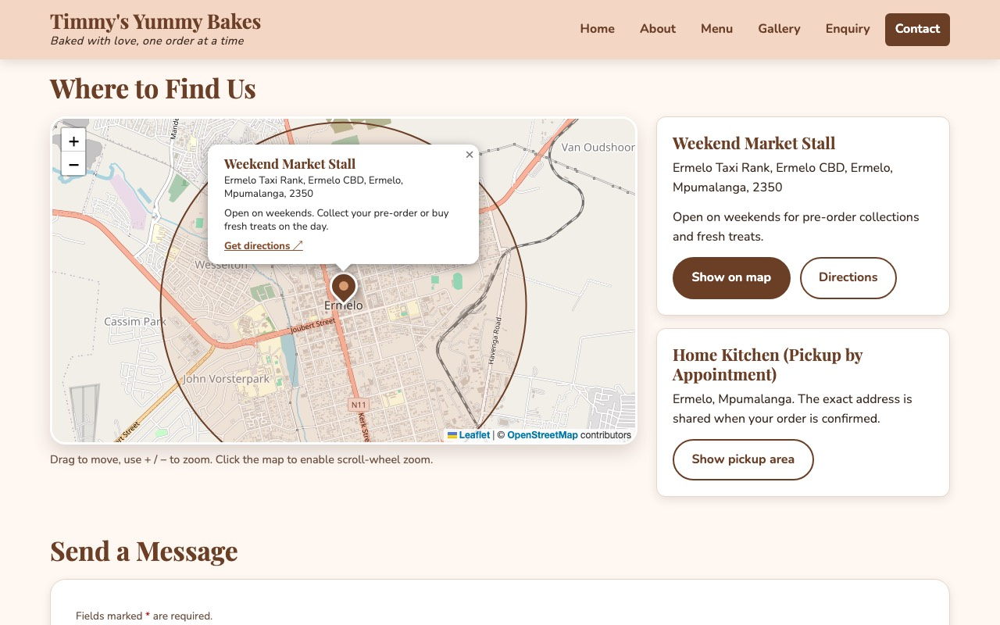

# Timmy's Yummy Bakes

A responsive, multi-page website for **Timmy's Yummy Bakes**, a small home bakery in Ermelo, Mpumalanga, run by a university student who bakes to fund her studies.

**Live site:** https://zimile.github.io/WEDE5020_Part3/
**Repository:** https://github.com/Zimile/WEDE5020_Part3

---

## Contents

1. [Project overview](#project-overview)
2. [Purpose and goals](#purpose-and-goals)
3. [Pages](#pages)
4. [Features](#features)
5. [Technologies used](#technologies-used)
6. [Project structure](#project-structure)
7. [Setup and running locally](#setup-and-running-locally)
8. [How the forms and email work](#how-the-forms-and-email-work)
9. [Customising content](#customising-content)
10. [SEO](#seo)
11. [Accessibility](#accessibility)
12. [Testing](#testing)
13. [Deployment (GitHub Pages)](#deployment-github-pages)
14. [Screenshots](#screenshots)
15. [Changelog](#changelog)
16. [References](#references)
17. [Author](#author)

---

## Project overview

Timmy's Yummy Bakes sells homemade celebration cakes, cupcakes and biscuits, baked fresh to order. Customers collect from the home kitchen by appointment or from a weekend market stall at the Ermelo taxi rank.

The site was built in three parts for WEDE5020:

| Part | Focus |
|------|-------|
| Part 1 | HTML structure and content for five pages |
| Part 2 | External CSS, typography, responsive layout |
| Part 3 | JavaScript interactivity, interactive map, gallery lightbox, dynamic searchable menu, validated forms with email, SEO and deployment |

## Purpose and goals

- Give the business a professional online presence that works well on phones, which is how most local customers browse.
- Let customers browse the menu and prices, then send an order enquiry and get an **instant estimated cost and availability check**.
- Make the weekend market stall easy to find with an interactive map.
- Reduce back-and-forth messages by validating enquiries properly before they are sent.

## Pages

| Page | File | What it does |
|------|------|--------------|
| Home | `index.html` | Hero, customer favourites, image slider, ordering steps, call to action |
| About | `about.html` | The business story, values, FAQ accordion, credits and references |
| Menu | `menu.html` | Product cards rendered from data, live search, category filters, sorting |
| Gallery | `gallery.html` | Filterable photo grid with a full-screen lightbox |
| Enquiry | `enquiry.html` | Order enquiry form with validation, estimated cost and availability |
| Contact | `contact.html` | Contact details, Leaflet map, contact form that sends email |
| 404 | `404.html` | Friendly "page not found" page served by GitHub Pages |

## Features

### 1. Interactive elements (all pages)
- **Responsive hamburger navigation** below 900px, with `aria-expanded`, closing on link click, outside click or **Esc**.
- **Sticky header** that gains a shadow when scrolling.
- **Back-to-top button** that appears after scrolling 400px.
- **Scroll-reveal animations** using `IntersectionObserver` (switched off for users who prefer reduced motion).
- **Image slider** on the home page with previous/next buttons, dot navigation, auto-play, pause on hover/focus and swipe on touch screens.
- **FAQ accordion** on the About page that opens one answer at a time, with arrow-key, Home and End navigation between questions.
- Hover effects on cards, buttons and gallery photos.

### 2. Interactive map (`contact.html`, `js/map.js`)
- **Leaflet 1.9.4** with **OpenStreetMap** tiles, loaded from a CDN with Subresource Integrity hashes.
- A custom brand-coloured pin at the Ermelo taxi rank market stall. Its popup shows the name, address, a note and a **Get directions** link to Google Maps.
- The home kitchen is shown as a **pickup-area circle** rather than an exact pin, to protect the owner's privacy.
- Zoom and pan with mouse, touch or keyboard. Scroll-wheel zoom only switches on after the map is clicked, so the page doesn't get stuck.
- "Show on map" buttons fly the map to each location.
- If the CDN is unreachable, a fallback message and directions link appear instead of an empty box.

### 3. Gallery lightbox (`gallery.html`, `js/gallery.js`)
- Twelve photos, lazy-loaded (`loading="lazy"`) as compressed 480px thumbnails.
- Clicking a photo opens a lightbox with the full-size image, caption and "Photo X of Y" counter.
- **Next/previous** buttons, **← / →** arrow keys, **Esc** to close, **click outside** to close and **swipe** on touch screens.
- Focus moves into the dialog, stays trapped while it is open and returns to the photo afterwards. Page scrolling is locked while it is open.
- Category filter buttons; the lightbox steps only through the photos currently shown.

### 4. Dynamic content and search (`menu.html`, `js/products.js`, `js/menu.js`)
- All products are stored once in a JavaScript array (`js/products.js`) and rendered into cards. The enquiry form's product dropdown uses the same data, so prices always match.
- **Live, case-insensitive search** across name, description, category and tags. Multiple words narrow the results (e.g. "choc cup"), and matches are highlighted with `<mark>`.
- **Category filter buttons** (All / Cakes / Cupcakes / Biscuits) and a **sort** menu (price or name).
- A live result count read out by screen readers (`aria-live`).
- A friendly **no-results** message with a "Show all treats" button. **Esc** clears the search box.
- Filters are saved in the URL (`menu.html?category=cakes&q=red`), so links from the home page open a pre-filtered menu.
- Each product's **Enquire** button opens the enquiry form with that product already selected.

### 5. Enquiry form (`enquiry.html`, `js/enquiry.js`)
- **Fields:** full name, email, phone, occasion (dropdown), product (dropdown), quantity, date needed, collection method (radio buttons), order details (with character counter) and a consent checkbox.
- **Validation of every field** in JavaScript:
  - required fields
  - name: letters, spaces, hyphens and apostrophes only
  - email format
  - **South African phone format** (`0XX XXX XXXX` or `+27 XX XXX XXXX`)
  - quantity: a whole number from 1 to 50
  - **date not in the past** and no more than a year ahead
  - a cross-field rule: the market stall option must fall on a weekend
  - message: 20–500 characters
  - consent must be ticked
- Errors appear **next to each field** when you leave it, then update live as you type. Invalid fields are highlighted red and valid ones green.
- Submitting with errors shows a summary at the top with links that jump to each problem field. Nothing is sent until every field is valid.
- **On a valid submit:**
  - calculates the **estimated cost**: unit price × quantity, minus a 10% bulk discount on orders of R1 000 or more
  - checks **availability** against the 24–48 hour notice period
  - shows a summary with a reference number (e.g. `TYB-261109-241`)
  - emails the enquiry through Formspree and shows whether it was sent
  - clears the form

### 6. Contact form (`contact.html`, `js/contact.js`)
- **Fields:** name, email, phone (optional, but validated if filled in), subject dropdown and message.
- The same real-time inline validation and error summary as the enquiry form.
- **Sends a real email** through Formspree:
  - a **loading state** while sending (spinner, disabled button, `aria-busy`)
  - a **success message** that confirms the subject and reply address, then clears the form
  - an **error message** that keeps what the visitor typed and offers the phone number instead
  - a hidden honeypot field to filter spam bots, and a 15-second timeout

## Technologies used

| Technology | Use |
|------------|-----|
| HTML5 | Semantic structure (`header`, `nav`, `main`, `section`, `article`, `figure`, `footer`) |
| CSS3 | Custom properties, Flexbox, Grid, media queries, `clamp()`, transitions, `prefers-reduced-motion` |
| JavaScript (ES5/ES2015, no frameworks) | Interactivity, rendering, validation, `fetch` |
| [Leaflet 1.9.4](https://leafletjs.com/) | Interactive map |
| [OpenStreetMap](https://www.openstreetmap.org/) | Map tiles |
| [Formspree](https://formspree.io/) | Sends form submissions to email |
| [Google Fonts](https://fonts.google.com/) | Playfair Display (headings) and Nunito (body) |
| Git and GitHub | Version control |
| GitHub Pages | Hosting |

## Project structure

```
WEDE5020_2/
├── index.html, about.html, menu.html, gallery.html,
│   enquiry.html, contact.html, 404.html
├── css/
│   └── style.css          # all styles (design tokens at the top)
├── js/
│   ├── main.js            # nav, header, back-to-top, reveal, accordion, slider
│   ├── products.js        # product data (single source of truth)
│   ├── menu.js            # menu rendering, search, filters, sort
│   ├── gallery.js         # gallery filters and lightbox
│   ├── map.js             # Leaflet map and locations
│   ├── config.js          # Formspree endpoint and pricing rules
│   ├── form-utils.js      # shared validation and email sending
│   ├── enquiry.js         # enquiry form logic and estimate
│   └── contact.js         # contact form logic
├── images/                # descriptive, hyphenated, compressed images (+ -480 thumbnails)
├── screenshots/           # README screenshots
├── sitemap.xml
├── CHANGELOG.md
└── README.md
```

## Setup and running locally

No build step or install is needed.

1. Clone the repository:
   ```bash
   git clone https://github.com/Zimile/WEDE5020_Part3.git
   cd WEDE5020_Part3
   ```
2. Start a local web server. A server is recommended over double-clicking the files, so that `fetch` and the map behave as they will online:
   ```bash
   python3 -m http.server 8000
   ```
   Alternatively, use the **Live Server** extension in VS Code: right-click `index.html` and choose *Open with Live Server*.
3. Open http://localhost:8000 in your browser.

## How the forms and email work

Both forms use the shared `js/form-utils.js`:

1. Each field has a validation rule that returns an error message, or nothing if the value is valid.
2. Errors show when the visitor leaves a field (`blur`), then update live while they correct it (`input`).
3. On submit, every rule runs. If any fail, an error summary appears and focus moves to it.
4. If everything passes, the page's own handler runs. The enquiry page calculates and shows an estimate; the contact page shows a loading state. Both then send the data as JSON to Formspree with `fetch`.

### Setting up email (Formspree): the only key you need

1. Go to https://formspree.io and sign up with the email address that should **receive** messages.
2. Click **+ New Form**, name it (e.g. "Timmy's Yummy Bakes website") and create it.
3. Copy the form endpoint. It looks like `https://formspree.io/f/abcdwxyz`.
4. Open `js/config.js` and replace `https://formspree.io/f/YOUR_FORM_ID` with your endpoint.
5. Commit, push, then submit the contact form once on the live site. Formspree emails you a confirmation link; click it to activate the form.
6. *(Recommended)* In Formspree, open the form's **Settings** and add `zimile.github.io` under **Restrict to domain**.

Until the endpoint is set, both forms still validate and the enquiry estimate still works. The sending step shows a clear "email service hasn't been connected yet" message instead of failing silently.

The free plan allows 50 submissions a month. The enquiry and contact forms share one endpoint, and the `form` field in each email shows which page it came from.

## Customising content

| To change... | Edit |
|---|---|
| Products, prices, descriptions | `js/products.js` (the menu and enquiry form both update automatically) |
| Bulk discount, threshold, notice period | `SITE_CONFIG` in `js/config.js` |
| Map pin position | `MARKET_STALL.lat` / `lng` in `js/map.js`. Right-click the exact spot in Google Maps to copy the coordinates. |
| Colours and fonts | The `:root` tokens at the top of `css/style.css` |
| Gallery photos | Add a `<figure class="gallery-item">` in `gallery.html`. Put a full image and a `-480.jpg` thumbnail in `images/`. |

## SEO

- A unique `<title>` on every page (50–60 characters), including the business name and main keyword.
- A unique meta description on every page (150–160 characters), matching the page content.
- Tailored meta keywords per page, with no stuffing.
- `lang="en-ZA"`, viewport meta, canonical URLs and Open Graph and Twitter card tags for link previews.
- One `<h1>` per page and semantic landmarks.
- Every image is named descriptively with hyphens (e.g. `red-velvet-sponge-cake-layers.jpg`) and has meaningful `alt` text.
- schema.org `Bakery` structured data (JSON-LD) on the home page.
- `sitemap.xml`, plus a `noindex` 404 page.
- Performance: compressed progressive JPEGs, `srcset`/`sizes`, lazy loading, `width`/`height` attributes to prevent layout shift, and deferred scripts.

## Accessibility

- A skip-to-content link, visible `:focus-visible` outlines and keyboard support for every widget.
- Labels on every form control, `aria-describedby` linking hints and errors, `aria-invalid` on invalid fields, and `aria-live` result counts and status messages.
- ARIA patterns for the menu button, accordion, carousel and modal dialog.
- `prefers-reduced-motion` turns off animation, auto-play and smooth scrolling.
- Works without JavaScript: navigation stays visible, FAQ answers are expanded and the menu shows a `noscript` price list.

## Testing

Every page was tested in Chrome at desktop (1280px) and mobile (375px) widths with an automated headless browser script that checked for:

- no console errors, failed requests or 404s
- no broken images (after scrolling to trigger lazy loading)
- no horizontal scrolling on mobile
- exactly one `<h1>` per page
- all internal links, `#anchors`, `src` and `srcset` paths resolving to real files (217 references checked)

Interaction tests (49 checks) covered:

- menu search, filters, sorting, the no-results state and URL filters
- every way to use the lightbox: open, focus, arrows, wrap-around, Esc, click outside, and filtering
- the accordion
- every enquiry validation rule and the estimate maths
- the contact form's loading, success and failure states, using a mocked Formspree response
- the hamburger menu, back-to-top button and slider

## Deployment (GitHub Pages)

1. Push the `master` branch, which holds Parts 2 and 3, to GitHub:
   ```bash
   git push origin master
   ```
2. On GitHub, open the repository → **Settings** → **Pages**.
3. Under **Build and deployment**, set **Source** to *Deploy from a branch*, choose **master** and **/ (root)**, then click **Save**.
4. Wait 1–2 minutes. The site will be live at **https://zimile.github.io/WEDE5020_Part3/**.
5. Check every page on the live URL (including on your phone), then add your Formspree endpoint as described above.

All file paths are relative, so the site works from the `/WEDE5020_Part3/` sub-path without changes.

## Screenshots

| Home (desktop) | Mobile navigation |
|---|---|
|  |  |

| Menu live search | Gallery lightbox |
|---|---|
|  |  |

| Enquiry validation | Interactive map |
|---|---|
|  |  |

## Changelog

See [CHANGELOG.md](CHANGELOG.md) for the full, dated history. Summary:

- **2026-11-02 (Part 3):** JavaScript interactivity, Leaflet map, gallery lightbox, dynamic searchable menu, validated enquiry and contact forms with Formspree email, SEO, image optimisation, testing and GitHub Pages preparation.
- **2026-09-25 (Part 2):** External stylesheet, typography, responsive navigation and layouts.
- **Part 1:** HTML structure and content for the five original pages.

## References

References use the Harvard style.

**Images**

- *[Image source(s) to be confirmed: please provide the origin of `cakes.jpg`, `cupcakes.jpg` and `biscuits.jpg`, from which all images in `/images` were cropped.]*

**Libraries, services and fonts**

- Agafonkin, V. (2023) *Leaflet* (Version 1.9.4) [JavaScript library]. Available at: https://leafletjs.com/ (Accessed: 2 November 2026).
- OpenStreetMap contributors (2026) *OpenStreetMap*. Available at: https://www.openstreetmap.org/copyright (Accessed: 2 November 2026).
- OpenStreetMap Foundation (2026) *Nominatim geocoding service*. Available at: https://nominatim.openstreetmap.org/ (Accessed: 2 November 2026).
- Formspree (2026) *Formspree: form backend and API*. Available at: https://formspree.io/ (Accessed: 2 November 2026).
- Sørensen, C.E. (2011) *Playfair Display* [Typeface]. Google Fonts. Available at: https://fonts.google.com/specimen/Playfair+Display (Accessed: 2 November 2026).
- Adams, V., Cyreal and Le Bailly, J. (2014) *Nunito* [Typeface]. Google Fonts. Available at: https://fonts.google.com/specimen/Nunito (Accessed: 2 November 2026).

**Tutorials and documentation**

- MDN Web Docs (2026) *Client-side form validation*. Available at: https://developer.mozilla.org/en-US/docs/Learn_web_development/Extensions/Forms/Form_validation (Accessed: 2 November 2026).
- MDN Web Docs (2026) *Intersection Observer API*. Available at: https://developer.mozilla.org/en-US/docs/Web/API/Intersection_Observer_API (Accessed: 2 November 2026).
- MDN Web Docs (2026) *Using the Fetch API*. Available at: https://developer.mozilla.org/en-US/docs/Web/API/Fetch_API/Using_Fetch (Accessed: 2 November 2026).
- W3C Web Accessibility Initiative (2024) *ARIA Authoring Practices Guide: Accordion, Carousel and Dialog (Modal) patterns*. Available at: https://www.w3.org/WAI/ARIA/apg/patterns/ (Accessed: 2 November 2026).
- Schema.org (2026) *Bakery*. Available at: https://schema.org/Bakery (Accessed: 2 November 2026).
- GitHub (2026) *Creating a GitHub Pages site*. Available at: https://docs.github.com/en/pages/getting-started-with-github-pages/creating-a-github-pages-site (Accessed: 2 November 2026).

**AI tools**

- Anthropic (2026) *Claude* (Claude Opus 5.5, via Claude Code) [Large language model]. Available at: https://www.anthropic.com/claude (Accessed: 2 November 2026). Used to help write and test the Part 3 JavaScript, CSS refactor, SEO metadata and this documentation; all output was reviewed by the author.

## Author

- **Name:** Moarabi Tong
- **GitHub:** [MoarabiTong](https://github.com/MoarabiTong)
- **Module:** WEDE5020 (Web Development)
- **Student number:** *[add your student number]*
